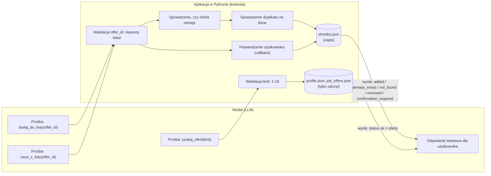

# Co model może zażądać, a co kontroluje aplikacja

## Czego model nie kontroluje

- Potwierdzenia usunięcia: argument `confirmed` podany przez model jest ignorowany. Potwierdzenie pochodzi tylko z callbacku aplikacji (`confirm`).
- Ścieżek do plików i danych: model podaje tylko `limit` i `offer_id`.
- Wag dopasowania: są stałe w `matching.py`.
- Zewnętrzny klient MCP dostaje tylko `szukaj_ofert` i `dodaj_do_listy`, bez usuwania.
